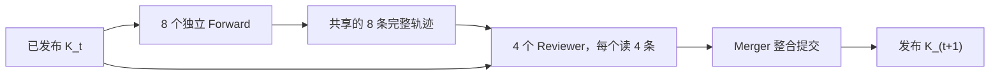

# CSI K20 训练设计

本轮使用 **shared full_random 4K**，从空 skills、空 memory 的 K0 连续发布 20 次更新，于 2026 年 11 月 18 日得到 K20。训练积累能跨问题复用的调查路径，包括从症状到源码的入口、组件和版本间的关系，以及能直接取证的工具。正式知识提交为 `36de135c08352aa6928c4d46208655728cb70097`。[版本说明](README.md) · [训练配置与来源](manifest.json)

## 数据与采样

冻结数据集含 1,243 条训练题、39 条验证题、25 条测试题，三个集合的 issue ID 互斥。Forward 收到 issue 标题、采集时的首帖和 URL，以及调查目标和环境提示。验证参考与主证据由 Judge 单独读取，Forward 仍可按工具权限查询公开材料。本轮终点评测使用验证集中的 12 题，测试集未用于本轮训练和终点评测。

原生 `Sampler` 以 seed 17 执行 100 步课程的前 20 步。每步先生成 4 组、每组 2 个 Point，形成 8 条独立的 Forward 坐标。每步的来源组是 3 细 1 粗。首题按版本加权采样，最新到最旧的归一化位置为 `a`，权重为 `exp(-ln(2) × a)`。后续题按冻结 Qwen3-Embedding-8B 余弦距离与组目标距离的偏差筛出候选组，再按版本权重有放回抽取，候选组数设为 4。

来源组控制采出的题，Reviewer 分组由另一个确定性随机流生成。每步从满足约束的分组中抽取并打乱 4 个 minibatch，每个包含 4 条不同的 Forward 轨迹，8 条轨迹各被使用两次。相同 issue 可有多个独立 Point。整个训练生成 160 条源轨迹，为 80 个 Reviewer 分配 320 份轨迹输入。[采样与输入身份](manifest.json)

## 从 Forward 到下一版本

| 角色 | 每步 | 输入与工作 |
| --- | ---: | --- |
| Forward | 8 | 从同一只读知识版本和独立对话出发，调查真实问题。累计输出上限 4,096 tokens，包含 reasoning。 |
| Reviewer | 4 | 等各自的 4 份源材料就绪后启动，在同一 Git 工作基点上独立更新 skills，并提交候选修改。 |
| Merger | 1 | 等 4 个 Reviewer 完成，整合候选提交、处理冲突、检查技能树和 Git 状态，生成下一知识版本。 |

Forward 和 Reviewer 可并行，模型并发上限配置为 64，下一步等待本步发布。训练配置使用 `volcengine/deepseek-v4.1-flash`，实际响应模型为 `deepseek-v4-1-flash-261017`，reasoning 为 `high`。在线学习、后台学习、memory 学习和 minibatch 重跑关闭，Reviewer／Merger 沿用各自的模型设置，本轮未另设累计输出或步数上限。

Reviewer 在文件视图里按需读取原生轨迹和历史消息。这里的「完整」指一次 4K Forward 所留下的全部记录，包括截断前的调查和未完成的回答。Reviewer 可用只读源码和公开来源核证，优先沉淀反复需要重建的查证路径，围绕实际复用条件组织技能入口、主题索引、专题正文与工具。Forward 通过技能索引和按需读取使用已发布知识。Merger 的输入是各 Reviewer 的 Git 提交与集成工作树，职责是协调重复或冲突的修改。

程序把整合后的技能和该步证据归档写入一个以旧 K 为父的正式提交。独立快照在 K05、K10、K15 和 K20 保存。第 8 步因旧轨迹归档残留而恢复发布，复用了原来的 8 个 Forward 和 4 个 Reviewer。第 19 步的 Merger 在服务恢复后从保留的会话和 Git 状态继续，复用了该步已完成的 Forward 与 Reviewer。20 个正式步骤均已发布。[版本链与恢复源码](provenance/execution-source.json)

## 知识结构与训练量

K20 的单一 [Skill 入口](profile/skills/vllm-ascend-bug-report-triage/SKILL.md)按线索引向[调查流程](profile/skills/vllm-ascend-bug-report-triage/references/workflow/index.md)、[症状](profile/skills/vllm-ascend-bug-report-triage/references/symptoms/index.md)、[vLLM-Ascend 源码与版本](profile/skills/vllm-ascend-bug-report-triage/references/vllm-ascend/index.md)及 [HCCL](profile/skills/vllm-ascend-bug-report-triage/references/hccl/index.md)。细分专题和 [issue 台账](profile/skills/vllm-ascend-bug-report-triage/references/symptoms/issue-ledger/index.md) 各有入口，版本解析、证据提取等操作由[脚本](profile/skills/vllm-ascend-bug-report-triage/scripts/)支持。

训练 loss 是合并前 4 个 Reviewer 的知识改写量均值。每份候选与共同 K 比较，先对消跨文件相同的非空行，再用剩余文本的插入和删除量估算 tokens。移动原文和拆并文件本身不增加该距离。发布后的净改写量另计，回答质量由独立评测衡量。

训练原始日志共记录 9,839 次模型请求尝试，8 次用量未知。按有记录用量估算，Forward、Reviewer、Merger 分别消耗 6.782、51.755、21.175 积分，合计约 **79.712 积分**。训练跨计费日期，完整账单无法从该前后窗口相减得出。[训练用量来源](manifest.json)

## 终点评测

将本版本与 [2026-11-02 扁平 K20](../2026-11-02-k20/) 放在同一波交错评测。12 个冻结验证题，每题每份 K 各执行 2 次独立 Forward，共 48 次，每次累计输出上限 32,768 tokens，含 reasoning。各条件共用任务提示、模型、工具和预算。题目此前用于项目验证，与本轮训练池的 ID 互斥。

原生 Judge 每题开一个会话，按该题冻结参考和主证据判定 4 次独立执行。独立事实复核在解盲前完成。实际执行的 `submit_to_judge` 是交付记录，有效执行无提交记 Q0。Q 衡量整题质量，workaround 和根因另外判定。U 为实耗输出量占预算的比例。校正 D 包含 Agent 构造和运行，扣除实测本地门控等待。聚合时先对同题重复取均值，再按题等权。每份 K 有一个复核 Q 未知，下表按未知值可能为 0 或 1 给出固定分母范围。

| 指标 | 2026-11-18 K20 | 2026-11-02 K20 |
| --- | ---: | ---: |
| 有效 Forward | 24/24 | 24/24 |
| 有实际提交的 Forward | 22/24 | 24/24 |
| 原生 Q | 79.2%（19/24） | 66.7%（16/24） |
| 匿名复核 Q | 37.5%–41.7%（9 次 Q1） | 29.2%–33.3%（7 次 Q1） |
| 输出预算占用 U | 26.8% | 48.5% |
| 校正 D | 69.3 秒 | 135.8 秒 |

本轮新 K20 平均输出量少 **44.8%**，校正交付时间短 **49.0%**，匿名复核 Q 高 **4.2–12.5 个百分点**。原生与匿名复核有 19 条整题判定分歧。新 K20 在首个调查批读到同案评论的执行有 23/24 次，旧 K20 为 0/24。新 K20 也有两次无实际提交，22 次技能脚本调用中有 14 次未能解析 ref。旧 K20 包含初始 Quay 工具和 K10 人工修正，训练使用 320 条 Forward。上述差异衡量这两份实际知识 profile 在此评测中的整体表现，无法单独归因于参考目录分层。[逐指标结果与原始记录身份](manifest.json)
